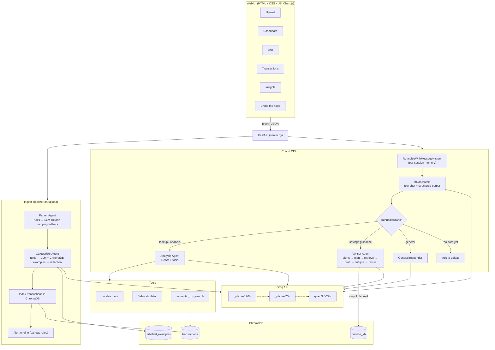

# SpendSense: Statement-to-Insights Finance Agent

**Agentic AI, Assignment 4.** A multi-agent personal-finance assistant. Upload a bank or UPI
statement (CSV or PDF); four agents parse it, categorise every transaction, compute spending trends
with real pandas/calculator tools, and explain the results in plain language with overspending
alerts and savings advice, through a web interface.

| | |
|---|---|
| **LLM** | Groq API: `gpt-oss-120b`, `gpt-oss-20b`, `qwen3.8-27b` (automatic fallback between them) |
| **Framework** | LangChain: prompt templates, LCEL chains, structured output, tool calling, memory |
| **Vector DB** | ChromaDB (local, persistent) with local ONNX embeddings |
| **Backend** | Python 3.12, FastAPI |
| **Frontend** | HTML + CSS + JavaScript (no framework), Chart.js |

> All sample data is synthetic and fictional. The app gives general budgeting guidance, not financial advice.

---

## Contents
1. [Quick start (step by step)](#1-quick-start-step-by-step)
2. [Guided tour: what to try](#2-guided-tour-what-to-try)
3. [How the acceptance criteria are met](#3-how-the-acceptance-criteria-are-met)
4. [Architecture](#4-architecture)
5. [The four agents](#5-the-four-agents)
6. [Prompt engineering](#6-prompt-engineering)
7. [Results](#7-results)
8. [Running the tests](#8-running-the-tests)
9. [Project structure](#9-project-structure)
10. [Troubleshooting](#10-troubleshooting)
11. [Limitations](#11-limitations)

---

## 1. Quick start (step by step)

You need **Python 3.12** (tested; 3.11 should also work, but 3.13+ is not yet supported by some dependencies),
**git**, and a **free Groq API key**. Setup takes about 5 minutes.

### Step 1: Get a free Groq API key
1. Go to **https://console.groq.com** and sign in (Google/GitHub sign-in works).
2. Open **API Keys** → **Create API Key**, give it any name, and copy the key (it starts with `gsk_`).
   Keep it handy for Step 4. The key is free; no payment details are needed.

### Step 2: Download the project
```bash
git clone https://github.com/irudayajason/Agentic-Ass1.git
cd Agentic-Ass1
```

### Step 3: Create a virtual environment and install the dependencies

**macOS / Linux**
```bash
python3.12 -m venv .venv
source .venv/bin/activate
pip install --upgrade pip
pip install -r requirements.txt
```

**Windows (PowerShell)**
```powershell
py -3.12 -m venv .venv
.venv\Scripts\Activate.ps1
python -m pip install --upgrade pip
pip install -r requirements.txt
```
(If PowerShell blocks the activation script, run `Set-ExecutionPolicy -Scope CurrentUser RemoteSigned` once.)

Installation takes 1–3 minutes.

### Step 4: Add your Groq API key
Copy the example settings file to `.env`:

```bash
cp .env.example .env          # macOS / Linux
copy .env.example .env        # Windows
```

Open `.env` in any text editor and replace `your_groq_api_key_here` with your key:

```
GROQ_API_KEY=gsk_your_key_here
```

Save the file. `.env` is listed in `.gitignore`, so the key is never committed, and the server never
sends it to the browser.

### Step 5: Check the setup
```bash
python scripts/check_setup.py
```
You should see four `OK` lines: packages, `.env` loaded, local embeddings + ChromaDB search, and a
live Groq call. The first run downloads a small embedding model (~70 MB) once.

### Step 6: Start the app
```bash
uvicorn server:app --port 8000
```
(macOS/Linux can also use `./run.sh`.) Then open **http://localhost:8000** in a browser.

Stop the server with `Ctrl + C`. Next time, only Step 3's `activate` line and Step 6 are needed.

---

## 2. Guided tour: what to try

1. **Upload tab → "Load sample statement".** A four-step pipeline runs (Parser → Categorizer →
   Vector DB → Alerts) and a summary card shows how many transactions were labelled by rules vs the LLM.
   You can also upload your own CSV/PDF, or try **"Unusual layout (LLM parser)"** to see the LLM work
   out an unfamiliar file format.
2. **Dashboard.** KPIs, income vs spending, spending by category, weekly trend, top payees, 50/30/20
   check and "savings levers". All of these are computed with pandas; no LLM is involved.
3. **Ask (chat).** Try these, and open **"How I got this answer"** under each reply:
   - *Where did most of my money go in September?* → intent router → Analysis Agent → pandas tool
   - *And how does that compare with August?* → follow-up resolved from conversation memory
   - *Find that payment I made at a medical store* → the agent **chooses** a ChromaDB similarity search
   - *Which transaction is the highest amount?* / *Who sent me the most money?*
   - *How can I save ₹5,000 more every month?* → Advisor Agent: decides to retrieve guidance, cites
     sources, critiques its own draft, and checks every number in code
   - *What was my savings rate in July?* → the Advisor decides **no** retrieval is needed
4. **Transactions.** Search, filter, sort, export CSV. Change a category with the dropdown; the
   correction is saved to ChromaDB and reused as an example for future statements.
5. **Insights.** A plain-language summary, alerts ranked by severity, subscriptions, month by month.
6. **Under the hood.** The 7 acceptance criteria, **every system and user prompt** labelled by
   technique, and a live ChromaDB similarity-search box.

The sample is 4 months (Jul–Oct 2026) of synthetic transactions with a planted overspending spike
in September, so the alerts have something to find.

---

## 3. How the acceptance criteria are met

| # | Criterion | Where to see it |
|---|---|---|
| 1 | **LLM integration** | Groq via `langchain-groq` ([`spendsense/llm.py`](spendsense/llm.py)). The status pill in the UI shows the live model; each chat answer shows which model answered. |
| 2 | **Interactive GUI** | [`frontend/`](frontend/): upload, dashboard, chat with reasoning trace, editable transactions table, insights, under-the-hood tab. |
| 3 | **Prompt engineering** | 11 prompts in [`spendsense/prompts.py`](spendsense/prompts.py), each split into **System** and **User** parts and labelled with its technique (few-shot, dynamic few-shot, Chain-of-Thought, ReAct, reflection, zero-shot, structured output). All are visible in the *Under the hood* tab. |
| 4 | **LangChain core** | `ChatPromptTemplate`, `FewShotChatMessagePromptTemplate`, `MessagesPlaceholder`; LCEL `prompt \| llm \| StrOutputParser()` and `prompt \| llm.with_structured_output(Schema)` ([`chains.py`](spendsense/chains.py)); `RunnableBranch`, `RunnablePassthrough`, `RunnableWithMessageHistory`, `.with_fallbacks()` ([`orchestrator.py`](spendsense/orchestrator.py)). |
| 5 | **Agentic RAG** | Retrieval is a decision, not a fixed step: the Analysis Agent calls `semantic_txn_search` only for vaguely described transactions, and the Advisor's planning step decides whether to search the knowledge base and writes the queries. Weak matches are dropped; sources are cited. The chat trace shows each decision. |
| 6 | **Intent detection & routing** | Few-shot router with structured output → 4 intents → `RunnableBranch` to the Analysis Agent, the Advisor Agent or the general responder (+ a guard when no statement is loaded). Keyword fallback if the LLM is unavailable. Intent is shown on every answer. |
| 7 | **Vector database** | ChromaDB with three collections: `finance_kb` (20 budgeting notes → 76 chunks), `transactions` (one document per transaction, with metadata filters), `labelled_examples` (the categoriser's memory). Embeddings: `BAAI/bge-small-en-v1.5` (local, via fastembed). |

---

## 4. Architecture



**Design principle: the LLM decides and explains; tools compute.** No total, average or percentage
in an answer comes from the model's own arithmetic. Pandas, the calculator and the rule engine
compute them, and the Advisor's numbers are verified by code before they are shown.

---

## 5. The four agents

| Agent | File | How it works |
|---|---|---|
| **Parser** | [`parser_agent.py`](spendsense/agents/parser_agent.py) | Reads CSV (encoding + delimiter detection) or PDF tables. Maps columns using a synonym table; if the layout is unknown, the LLM returns a `ColumnMapping`, which is validated against the real header. Handles ₹, Indian lakh commas, Dr/Cr, failed rows, and bank prefixes (e.g. `DEP TFR UPI/…`). Extracts payee, payment mode, UPI ID and note, then **self-checks every running balance**. |
| **Categorizer** | [`categorizer_agent.py`](spendsense/agents/categorizer_agent.py) | Tier 1: keyword rules for known merchants. Tier 2: the remaining payees are grouped and sent to the LLM with **similar labelled payees retrieved from ChromaDB as few-shot examples**, step-by-step reasoning and a confidence score. Tier 3: low-confidence labels get a **reflection** pass. If no LLM is available, it falls back to the nearest labelled payee in ChromaDB. User corrections are stored for next time. |
| **Analysis** | [`analysis_agent.py`](spendsense/agents/analysis_agent.py), [`pandas_tools.py`](spendsense/tools/pandas_tools.py) | **ReAct loop** built with LCEL (`prompt \| llm.bind_tools(tools)`): Thought → tool call → Observation → … → answer. 8 tools: overview, category totals, monthly trend, top payees, filter/sort transactions, compare periods, safe calculator, and `semantic_txn_search` (ChromaDB). |
| **Advisor** | [`advisor_agent.py`](spendsense/agents/advisor_agent.py), [`alerts.py`](spendsense/tools/alerts.py) | A rule engine finds problems in rupees (overspent months, category spikes, 50/30/20, small-UPI habits, subscriptions, EMI ratio) and precomputes savings levers. Then: **retrieval plan** → retrieve → Chain-of-Thought draft with `[source: …]` citations → **self-critique** → number check in code → revise only if needed. |

---

## 6. Prompt engineering

| Prompt | Agent | Techniques |
|---|---|---|
| Intent classifier | Router | Few-shot (9 examples), structured output |
| Statement column mapping | Parser | Few-shot (2 example layouts), structured output |
| Transaction categoriser | Categorizer | Dynamic few-shot (from ChromaDB), Chain-of-Thought, structured output |
| Categoriser self-check | Categorizer | Reflection, structured output |
| Analysis agent | Analysis | ReAct, tool calling |
| Retrieval decision | Advisor | Agentic RAG (retrieve or not), structured output |
| Savings advisor | Advisor | Chain-of-Thought, RAG grounding with citations |
| Advice self-critique | Advisor | Reflection, structured output |
| Advice revision | Advisor | Reflection |
| Statement summary | Advisor | Zero-shot, grounded generation |
| General responder | Router branch | Zero-shot |

Two lessons that shaped the prompts during testing:
- **Few-shot answers must match the output format.** Text-style examples made the model ignore the
  JSON schema; writing the examples as the exact JSON fixed it.
- **Don't let the LLM do arithmetic.** The Advisor now receives precomputed savings levers and
  50/30/20 gaps in rupees, is told to copy them, and code checks every ₹ amount and % in the answer.

---

## 7. Results

Measured on the synthetic sample (336 transactions) with the scripts in [`scripts/`](scripts/):

| What | Result |
|---|---|
| Parser: bank CSV and PDF vs ground truth | 336/336 rows exact; 0 running-balance mismatches |
| Parser: UPI-app export | 301/301 UPI rows matched; 3 failed rows correctly dropped |
| Parser: unknown layout (LLM fallback) | All 5 columns + date format mapped correctly |
| Categorizer vs ground truth | **95.8 %** (rules 100 %, LLM 90 %) using 2 LLM calls |
| Intent router (28 labelled questions + 2 follow-ups) | **100 %** |
| Analysis Agent (7 questions incl. a follow-up) | **7/7** correct numbers, checked against pandas |
| Knowledge-base search | Right note ranked first for every test question; off-topic queries return nothing |

---

## 8. Running the tests

```bash
python -m pytest -q
```
**144 tests**, no API key or internet needed (the LLM is replaced by scripted fakes). They cover the
parser against ground truth, the categoriser tiers and fallbacks, retrieval, tools, the ReAct loop,
the Advisor's critique/revision logic, routing, memory and every API endpoint.

Live evaluation scripts (these use your Groq quota):
```bash
python scripts/eval_router.py    # router accuracy on 28 labelled questions
python scripts/demo_phase4.py    # categoriser accuracy vs ground truth
python scripts/demo_phase6.py    # Analysis Agent answers vs pandas
python scripts/demo_phase7.py    # Advisor: alerts, retrieval, critique, insights
python scripts/demo_phase8.py    # a full conversation through the router
```
To regenerate the synthetic data: `python data/generate_sample.py`.

---

## 9. Project structure

```
├── server.py                  FastAPI app: JSON API + serves the frontend
├── run.sh                     start script (macOS/Linux)
├── requirements.txt           pinned dependencies
├── .env.example               copy to .env and add your Groq key
├── frontend/                  index.html, styles.css, app.js
├── spendsense/
│   ├── config.py              paths, models, categories, thresholds
│   ├── llm.py                 Groq models, fallbacks, local embeddings
│   ├── prompts.py             all system/user prompts, labelled by technique
│   ├── schemas.py             Pydantic models for structured LLM output
│   ├── chains.py              LCEL chain builders
│   ├── router.py              intent detection
│   ├── memory.py              per-session chat history
│   ├── orchestrator.py        ingest pipeline + LCEL chat routing
│   ├── views.py               dashboard / table data for the UI
│   ├── agents/                parser, categorizer, analysis, advisor
│   ├── tools/                 pandas tools, safe calculator, alert engine
│   └── rag/                   ChromaDB access, retrieval, knowledge_base/*.md
├── data/
│   ├── generate_sample.py     synthetic statement generator
│   └── samples/               bank CSV, UPI CSV, PDF, unusual layout, ground truth
├── scripts/                   setup check, evaluation and demo scripts
└── tests/                     pytest suite
```

---

## 10. Troubleshooting

| Problem | Fix |
|---|---|
| `GROQ_API_KEY is not set` | Make sure the file is named exactly `.env` (not `.env.txt`), sits in the project root, and contains `GROQ_API_KEY=gsk_...`. Restart the server after editing it. |
| Chat says *"The free Groq quota is used up for the moment"* | Groq's free tier allows ~8,000 tokens/minute and ~200,000 tokens/day per model. Wait a minute between questions. Uploading, the dashboard, transactions and alerts keep working without the LLM. |
| `address already in use` | Another app uses port 8000; run `uvicorn server:app --port 8001` and open http://localhost:8001. |
| `pip install` fails on chromadb / onnxruntime | Use Python 3.12 (`python --version` inside the activated venv). |
| Model not found error | Groq occasionally renames models. Pick current names from https://console.groq.com/docs/models and set `LLM_MODEL` / `ROUTER_MODEL` / `BACKUP_MODEL` in `.env`. |
| First start or first upload is slow | The embedding model downloads once (~70 MB); embedding a few hundred transactions takes ~20 s on CPU. |
| Uploaded statements disappear after a restart | By design: statements are kept in memory only and never written to disk. |

---

## 11. Limitations

- **Free-tier rate limits.** A full advice answer uses ~10–15k tokens. Answers take 3–40 s; back-to-back
  questions slow down while the per-minute quota refills. The app falls back across three models.
- **State.** Sessions live in memory, and the ChromaDB transaction index holds one statement at a time,
  which suits a single-user demo.
- **Data.** Tested on synthetic statements and common Indian bank formats; unknown layouts go through the
  LLM column-mapping fallback. Scanned (image-only) PDFs are not supported.
- **Frontend.** A custom HTML/CSS/JS interface over FastAPI is used instead of Streamlit, to support the
  per-answer reasoning trace and the editable transactions table. The criteria require an interactive
  GUI, which this provides.
- **Advice.** General budgeting education with cited sources, not personalised financial advice.
